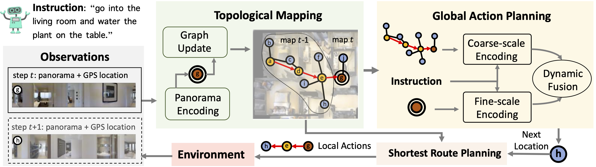

# DUET 子指令感知融合 · R2R 研究验证

这是基于 [官方 VLN-DUET](https://github.com/cshizhe/VLN-DUET) 的研究修改版，非官方仓库。基准提交：`93e8b233164bc079a6db48b8a0a78d123ec8de41`。

在原有 global/local 融合门控中加入子指令注意力残差，复用已有 R2R 微调 checkpoint，冻结主干，仅训练融合门控与新增模块，无需重新预训练。

- **[中文运行说明与实验配置](README-pilot-zh.md)**
- **[训练后诊断：参数变化、残差与动作对比](DIAGNOSIS.md)**
- [核心融合模块](map_nav_src/models/semantic_fusion.py)
- [小规模实验入口](tools/run_semantic_pilot.py)
- [对照实验脚本](tools/run_r2r_semantic_pilot.sh)
- [验证脚本](tools/test_semantic_pilot.py)

提供原始门控、整句均值、token attention、语义分块、等长分块对照。代码不包含数据集或模型权重。

验证状态：纯 Python 测试、语法检查已通过；PyTorch 数值检查与真实 GPU/MatterSim 导航尚未完成。请先在已有 DUET 环境中运行 `python tools/test_semantic_pilot.py --require-torch`。当前不声明性能提升。

---

以下保留官方 DUET 说明与引用信息。

# Think Global, Act Local: Dual-scale GraphTransformer for Vision-and-Language Navigation

This repository is the official implementation of [Think Global, Act Local: Dual-scale GraphTransformer for Vision-and-Language Navigation](https://arxiv.org/abs/2202.11742). 

Winner of the [ICCV 2021 Workshop Human Interaction for Robotic Navigation REVERIE & SOON Challenges](https://human-interaction4robotic-navigation.github.io/challenge.html).

Project webpage: [https://cshizhe.github.io/projects/vln_duet.html](https://cshizhe.github.io/projects/vln_duet.html).

Following language instructions to navigate in unseen environments is a challenging problem for autonomous embodied agents. The agent not only needs to ground languages in visual scenes, but also should explore the environment to reach its target. In this work, we propose a dual-scale graph transformer (DUET) for joint long-term action planning and fine-grained cross-modal understanding. We build a topological map on-the-fly to enable efficient exploration in global action space. To balance the complexity of large action space reasoning and fine-grained language grounding, we dynamically combine a fine-scale encoding over local observations and a coarse-scale encoding on a global map via graph transformers. The proposed approach, DUET, significantly outperforms state-of-the-art methods on goal-oriented vision-and-language navigation (VLN) benchmarks REVERIE and SOON. It also improves the success rate on the fine-grained VLN benchmark R2R.




## Requirements

1. Install Matterport3D simulators: follow instructions [here](https://github.com/peteanderson80/Matterport3DSimulator). We use the latest version instead of v0.1.
```
export PYTHONPATH=Matterport3DSimulator/build:$PYTHONPATH
```

2. Install requirements:
```setup
conda create --name vlnduet python=3.8.5
conda activate vlnduet
pip install -r requirements.txt
```

3. Download data from [Dropbox](https://www.dropbox.com/sh/u3lhng7t2gq36td/AABAIdFnJxhhCg2ItpAhMtUBa?dl=0), including processed annotations, features and pretrained models of REVERIE, SOON, R2R and R4R datasets. Put the data in `datasets' directory.

4. Download pretrained lxmert
```
mkdir -p datasets/pretrained 
wget https://nlp.cs.unc.edu/data/model_LXRT.pth -P datasets/pretrained
```

## Pretraining

Combine behavior cloning and auxiliary proxy tasks in pretraining:
```pretrain
cd pretrain_src
bash run_reverie.sh # (run_soon.sh, run_r2r.sh, run_r4r.sh)
```

## Fine-tuning & Evaluation

Use pseudo interative demonstrator to fine-tune the model:
```finetune
cd map_nav_src
bash scripts/run_reverie.sh # (run_soon.sh, run_r2r.sh)
```
